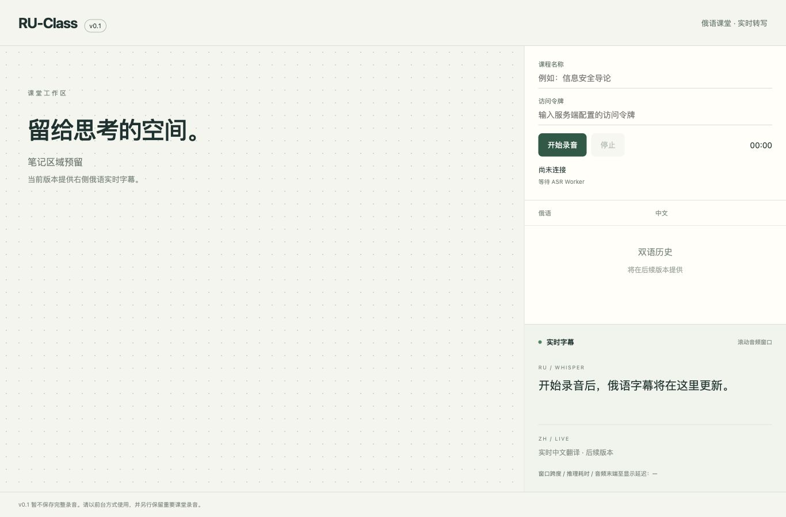

# RU-Class · v0.1

俄语课堂实时字幕原型。左侧 2/3 预留笔记区，右下显示真实 Whisper 滚动窗口字幕、录音时间和延迟指标；双语历史和中文翻译标注为后续版本。**v0.1 不保存完整录音，不适合作为重要课堂的唯一录音。**

浏览器 AudioWorklet → Node.js 网关 → 主动出站连接的 Node.js Worker → 常驻 whisper.cpp `whisper-server`。跨平台架构，当前在 M1 / 8 GB 上开发，small/Metal 的真实联调已通过；Mac mini M4 留待后期正式验收。当前验证事实见 [报告](docs/acceptance-v0.1.md)。其他操作系统尚未由作者验证，欢迎自行部署并反馈。

## 本地运行

要求 Node.js 22.6+、npm；使用 Chrome/Safari 等支持 AudioWorklet 的现代浏览器。

```sh
npm ci
cp .env.example .env
# 在本地生成两个不同随机令牌：node -e "console.log(require('crypto').randomBytes(32).toString('hex'))"
# 将令牌填入 .env 的 CLIENT_TOKEN / WORKER_TOKEN
node --env-file=.env --import tsx apps/server/src/index.ts
```

在相邻的 `ru-class-asr` 仓库按其 README 启动 whisper-server 与 Worker（Worker 使用相同 WORKER_TOKEN）。打开 `http://localhost:3000`，输入 CLIENT_TOKEN，点击开始并允许麦克风，说俄语。等待字幕在讲话期间更新，再点击停止，等待尾部完成。令牌留在内存，不写浏览器存储。无演示假字幕。

```sh
npm test
npm run typecheck
npm run build
# 已构建时：node --env-file=.env dist/apps/server/src/index.js
```

从仓库根目录运行服务。`HOST` 默认 `127.0.0.1`，`PORT` 默认 3000。完整配置见 `.env.example`。源码目录：`apps/web` 为页面与采集，`apps/server/src` 为认证/路由/协议，`tests` 为音频和 WS 测试。

## VPS 独立部署

先在独立目录执行 `npm ci && npm run build`，将 `.env` 留在服务器本地并限制读取权限。进程管理器从该目录运行 `node --env-file=.env dist/apps/server/src/index.js`，监听独立 loopback 端口。反向代理提供 HTTPS，转发 `/` 和 `/ws/*` 并允许 WebSocket Upgrade，设置 `PUBLIC_ORIGIN=https://class.example.org`。只公开 HTTPS 入口，Worker 通过 `wss://class.example.org/ws/worker` 主动连入。不在 VPS 运行模型。实际生产部署需另行授权；本仓库未修改任何现有面板或服务。

## 排错与边界

- `/health` 返回网关状态和 Worker 是否在线。`WORKER_OFFLINE`：确认 Worker 推理探测已通过并使用正确令牌。`INFERENCE_FAILED`：检查本机 whisper-server 与模型。
- 麦克风要求安全上下文，公网必须 HTTPS；WS 升级失败检查代理和 PUBLIC_ORIGIN。权限被拒绝后在浏览器站点设置中允许麦克风。
- 网络、Worker、麦克风或采样连续性出错时结束本次采集，重新开始创建新会话；不承诺缺失音频恢复。保持页面前台，Safari 后台/锁屏不作保证。
- 字幕替换显示最近最多 8 秒窗口，历史尚未保存。窗口跨度、推理耗时和音频末端到显示估计分开显示；后者不包含设备输入缓冲，详见 [协议](docs/protocol.md)。后端显示 `unverified:*` 时不能视为 Metal 验证。

贡献请提供系统版本、CPU/GPU、推理后端、Node/whisper.cpp 版本、复现步骤及脱敏日志。勿提交令牌、`.env`、私人域名、课堂录音或个人资料。社区运行反馈不等同于作者亲测。

长期边界见 [PROJECT_SPEC.md](PROJECT_SPEC.md)，架构记录见 [decisions](docs/decisions.md)，开发进展见 [development log](docs/development-log.md)。

模块关系见 [architecture](docs/architecture.md)，完整自动化输出见 [test results](docs/test-results-v0.1.txt)。



M1 实测方法、模型版本和延迟数据见 [M1 development](docs/m1-development.md)，M4 后期流程见 [hardware validation](docs/hardware-validation.md)。
